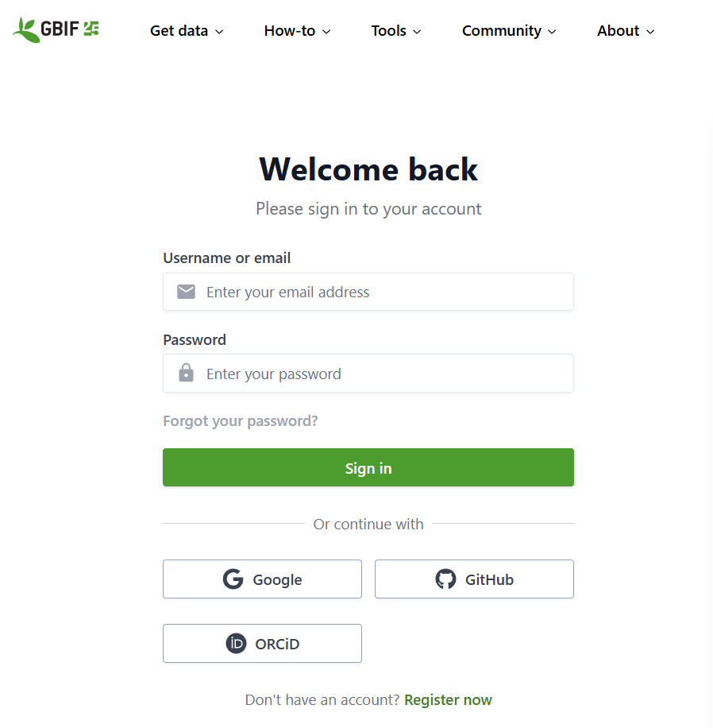

:::::::::::::::::::::::::::::::::::::: questions 

- How do we attribute scientific work across all areas of research - e.g. authoring papers?
- What activities with specimen data also need to be recorded to people?
- How can we assess the contribution of those who collected and determined specimen material?

::::::::::::::::::::::::::::::::::::::::::::::::

::::::::::::::::::::::::::::::::::::: objectives

- Understand ORCID as a researcher identifier
- Explore Bionomia
- See what extra information is given when Bionomia used in the GBIF data portal

::::::::::::::::::::::::::::::::::::::::::::::::

## ORCID - researcher identifier

Discussion - who has an ORCID identifier? When have you used it?

If you've used it for authoring scientific articles, what other research / curation activities have you done that could be added to your ORCID record?

## Collectors and determiners in specimen data

::::::::::::::::::::::::::::::::::::: challenge 

## Challenge 1: Install the Bionomia browser extension and explore the Kew specimen data on GBIF

1. Open a web browser (Chrome, Firefox or Edge)
2. Install the Bionomia extension from: https://chromewebstore.google.com/detail/bionomia/aodffghldlgnmhbeflkmokghpncnldcn (for Chrome / Edge) or https://addons.mozilla.org/en-US/firefox/addon/bionomia/ (for Firefox)
3. Explore a range of herbarium dataset pages on the GBIF data portal, e.g.: 
    - Kew herbarium: https://www.gbif.org/dataset/cd6e21c8-9e8a-493a-8a76-fbf7862069e5
    - Michigan herbarium: https://www.gbif.org/dataset/c8d12f8a-7e39-4e2c-92d7-825d590ad15b
   Can you find a link to see the collectors and determiners recorded in the herbarium dataset?
4. Explore the records in the Decaspermum dataset that we used in the Open Refine lesson, e.g. these three different examples:
    - Wong s.n (2004): https://www.gbif.org/occurrence/4892728880
    - Wilson SAN 152564: https://www.gbif.org/occurrence/2828477366
    - Chew FRI 78692: https://www.gbif.org/occurrence/2515076356
  What extra information (if any) is displayed in the header of the page?

:::::::::::::::::::::::: solution 

:::::::::::::::::::::::::::::::::

::::::::::::::::::::::::::::::::::::::::::::::::

::::::::::::::::::::::::::::::::::::: keypoints 

- Specimen records provide rich evidence.
- They have variable levels of information - because of data availability, or the level of information digitised.
- Post digitisation processes (e.g. georeferencing) can make records more usable.

::::::::::::::::::::::::::::::::::::::::::::::::

