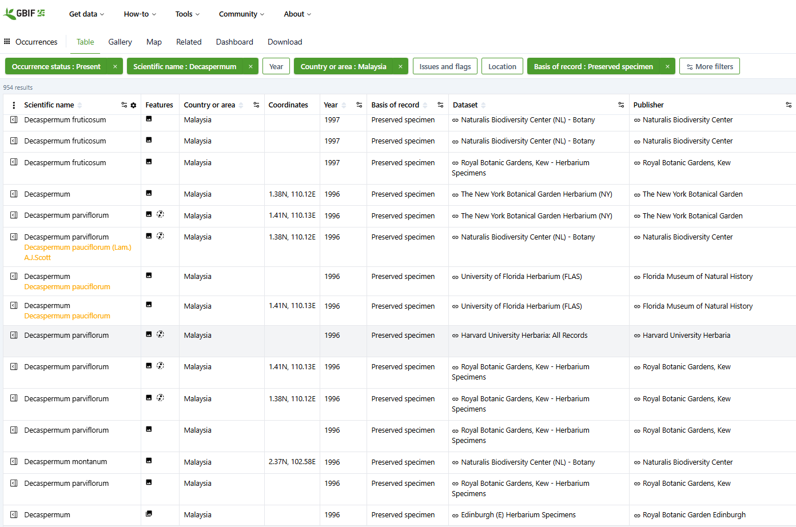
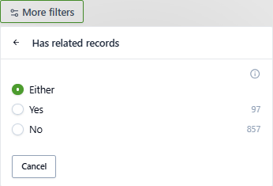
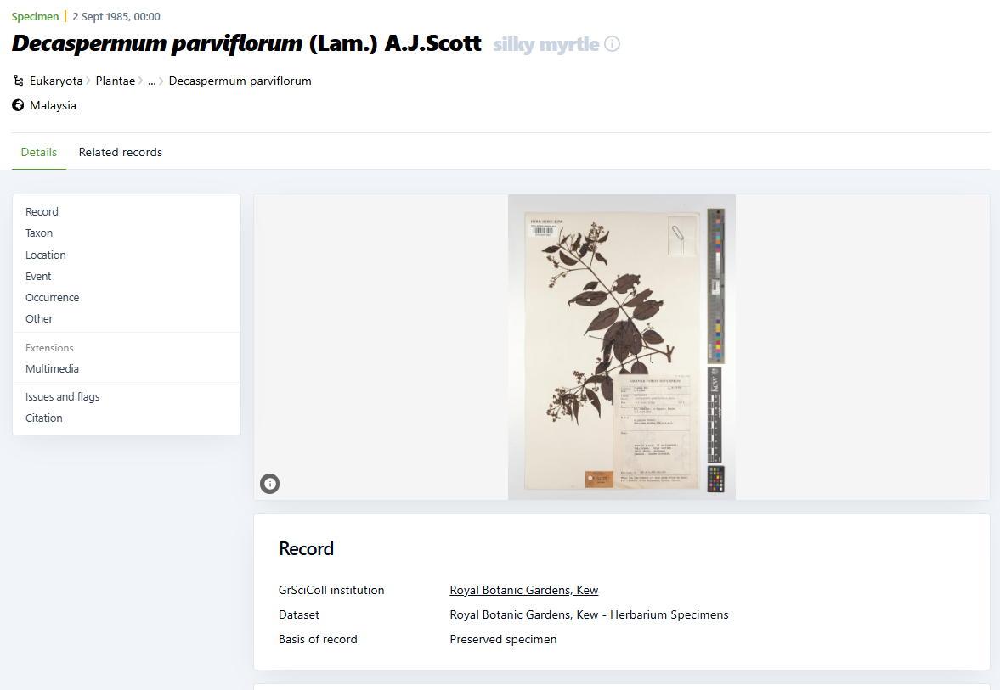
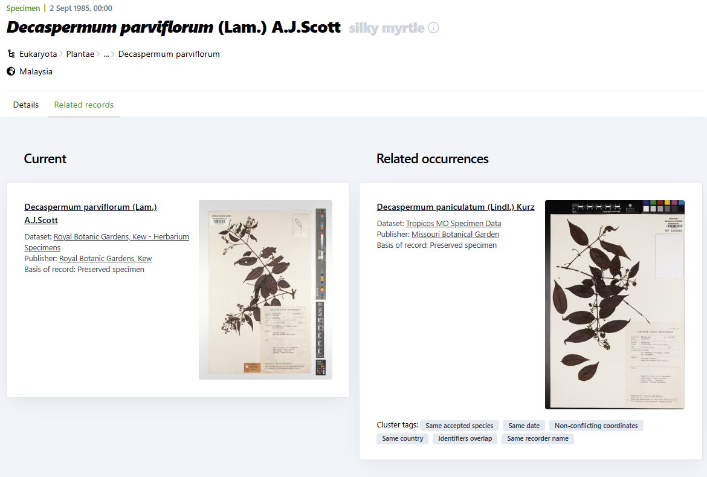

:::::::::::::::::::::::::::::::::::::: questions 

- What information have we mobilised through specimen digitisation?
- Where are specimen records available?
- What evidence do they provide? 

::::::::::::::::::::::::::::::::::::::::::::::::

::::::::::::::::::::::::::::::::::::: objectives

- Explore specimen duplicates found in the GBIF data portal

::::::::::::::::::::::::::::::::::::::::::::::::

## Context

In our previous session we looked at how records can be grouped up by the person who collected or determined them (career level aggregations).

In this session we will look at the set of specimens that arise from a single collecting event.

## Introduction

### Collecting event duplicates

Field collectors gather enough material in a collecting event to make multiple specimens, 
which are lodged into multiple different institutions.

As these can be digitised and curated separately, the data recorded about them can diverge.

GBIF run a process to identify related records, and one kind of "relatedness" is collecting event 
duplicates. This lesson will look at how to find and use this data.

### Decaspermum example

If we look at the Decaspermum dataset that we have been using: [Decaspermum in Malaysia (GBIF)](https://www.gbif.org/occurrence/search?occurrenceStatus=PRESENT&taxonKey=42C4&country=MY&basisOfRecord=PRESERVED_SPECIMEN&layout=occurrenceSummary_datasetKey_recordedBy.v-PIE_TaxonomicBreakdown)

The second column from the right is labelled "features". *Most* records in the dataset show a 
image icon to indicate that there is a specimen image available. *Some* records also display a 
node-graph icon to indicate that related records are available.

We can filter the dataset to only show records that also have related records

If we look at the details for a particular record, we see that there is an extra tab "related records"

This tab shows us the current record and the details of the records that have been identified as related

::::::::::::::::::::::::::::::::::::: challenge 

## Challenge 1: Exploring related records

Open the Decaspermum dataset

Filter for records with related records available.

Would you expect to see more duplicate records than GBIF have found? Why might these not be found?

Drill down into the details for a record with related records. Do all the records share the same scientifc name?

:::::::::::::::::::::::: solution 

Report back to the whole group.

:::::::::::::::::::::::::::::::::

::::::::::::::::::::::::::::::::::::::::::::::::

::::::::::::::::::::::::::::::::::::: keypoints 

- Collectors gather enough material to make duplicate specimens which are distributed in different herbaria.
- These can be digitised and managed separately.
- GBIF identify related records (including specimen duplicates) by running processes when they harvest specimen data.
- Related records can be queried and explored in the GBIF data portal.

::::::::::::::::::::::::::::::::::::::::::::::::

